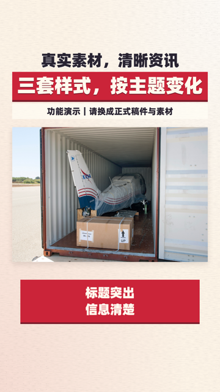
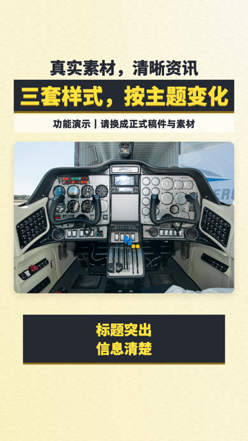
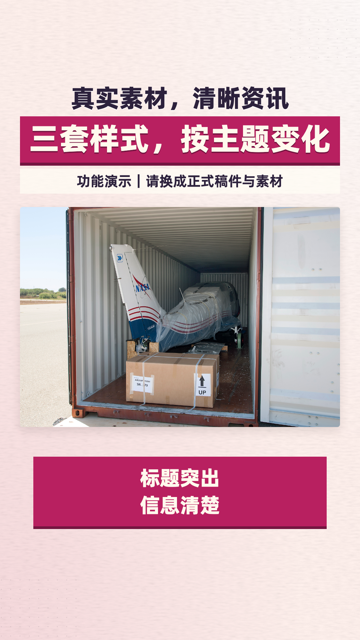
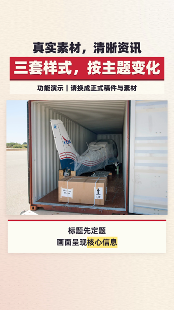
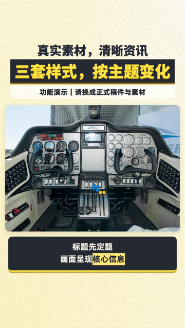
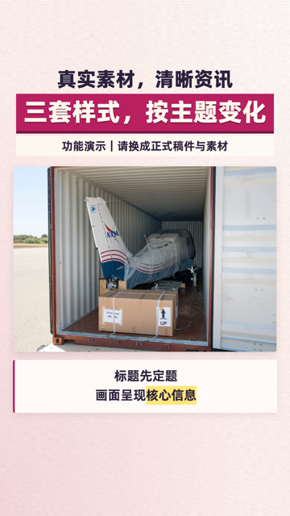
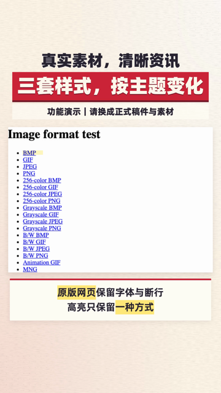
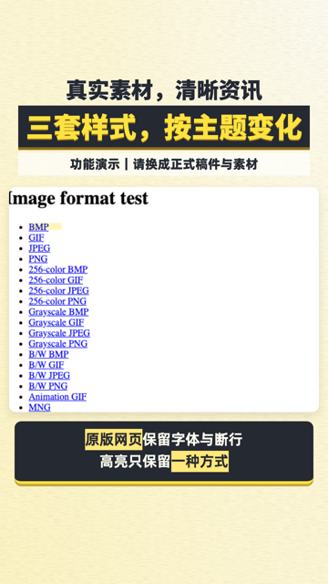
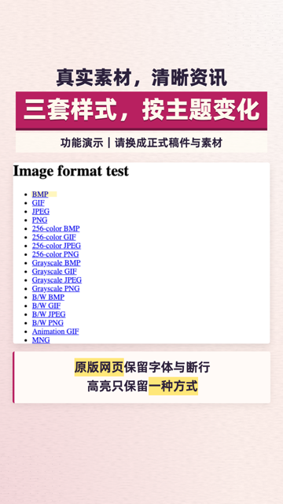

# v1.2 默认视觉基准（功能演示）

这些是实际Remotion输出的360px手机图，供安装后核对字体、标题厚度/底托、画幅、板型、正文居中、高亮与背景纹理。不是用户历史每一期的原样复制，不代表当前新闻事件，也没有附带客户原稿或媒体。

| 画面 | paper-red | speed-yellow | berry-progress |
|---|---|---|---|
| 封面 |  |  |  |
| 照片主导 |  |  |  |
| 原网页裁片 |  |  |  |

每套`*-record.json`保存实际字体文件哈希/字重、布局和标题。paper-red来自完整编码MP4帧；另外两套为实际Remotion静帧，未假称整片都编码验收。摄影和网页仅为测试素材，正式新闻须重新按本条事实选材。

## 原始素材及使用范围

- paper-red/berry照片：NASA X-57机身到达加州，2016年，公开领域影像。原件及作者/许可：[Wikimedia原文件说明](https://commons.wikimedia.org/wiki/File:X-57_Aircraft_Fuselage_Arrives_in_California_(AFRC2016-0212-037).jpg)；事件原始资料：[NASA说明](https://www.nasa.gov/image-article/fuselage-of-nasas-future-x-57-maxwell-all-electric-aircraft/)。只作版式实景测试，不暗示新签约或新交付。
- speed-yellow照片：同组NASA X-57驾驶舱照片，2016年，公开领域影像。[原件及许可说明](https://commons.wikimedia.org/wiki/File:X-57_Aircraft_Fuselage_Arrives_in_California_(AFRC2016-0212-109).jpg)。只作正常色彩与实景画幅测试。
- 原网页：[W3C Image format test](https://www.w3.org/People/mimasa/test/imgformat/)。截图取真实DOM裁片、保留原字体/断行，对BMP示范单一透明底色；它是网页渲染测试页面，**不是新闻报道**，不以演示片字幕冒充真实新闻内容。
- 所有标题和资讯文字均为本包功能说明，配乐为本地合成测试节奏，未称抖音曲目。第三方原素材及字体的条款不因仓库MIT代码许可而改变。
